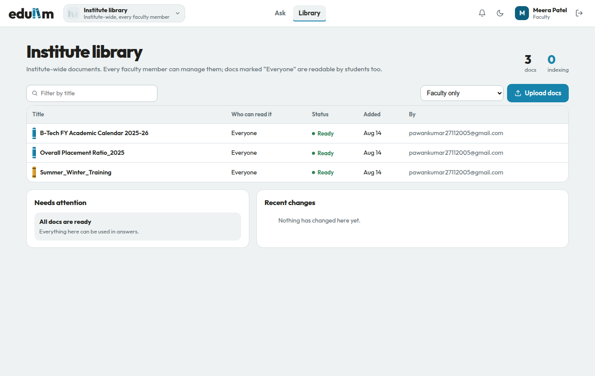
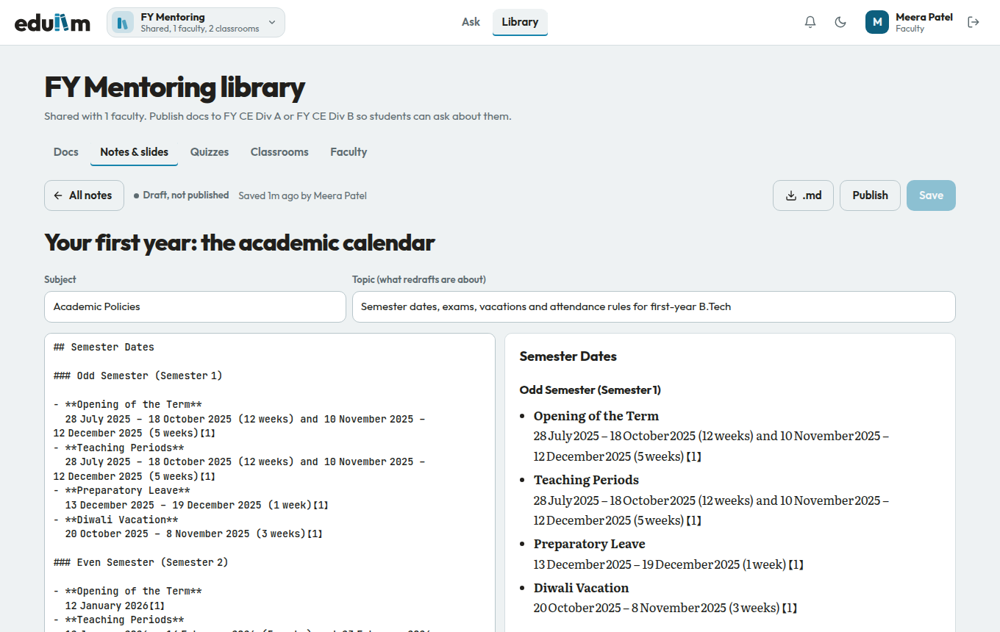

# Edu LLM — Institute Document Q&A

RAG over institute documents, with access scoped by workspaces and classrooms: restricted content is filtered out at retrieval, so it never reaches the LLM.

- **Ask:** multi-turn chat with history, sources and charts; search everything or one workspace / classroom.
- **Library:** institute library and faculty workspaces, classrooms with join codes, audit log and update notices.
- **Slides:** LLM-drafted `.pptx` lecture decks from chosen docs, kept up to date when sources change.
- **Quizzes:** a reviewed question bank; assignments that never repeat across classrooms in a term, and quizzes where every student gets a different set.
- Magic-link login; role derived from the `@scet.ac.in` address.

## Screenshots

| | |
|---|---|
|  Library |  Notes editor |
|  Question bank |  A quiz, one set per student |
|  Student's own quiz (no answers) | |

## Quick Start

```bash
# Terminal 1: backend
docker compose up -d postgres   # DB on port 5433; needed after every reboot
source .venv/bin/activate
cd backend
uvicorn app.main:app --reload

# Terminal 2: frontend
cd frontend
npm run dev
```

Then visit `http://localhost:5173` and sign in with your institute email (`firstname.lastname@scet.ac.in` for faculty, `name.co23d1@scet.ac.in` for students).

## Next Steps

- **Setup, config, troubleshooting** → [mds/SETUP.md](mds/SETUP.md)
- **How it works** → [mds/ARCHITECTURE.md](mds/ARCHITECTURE.md)
- **Plan & open items** → [mds/PLAN.md](mds/PLAN.md)

## Key Files

| File | Purpose |
|------|---------|
| `backend/app/main.py` | FastAPI server |
| `backend/app/rag/` | LangGraph Q&A pipeline |
| `backend/app/db/queries.py` | All SQL + access control |
| `backend/app/authoring/`, `backend/app/assessments/` | Notes/decks, question bank and quiz assignment |
| `frontend/src/chat/`, `library/`, `quizzes/` | Ask, Library, Quizzes UI |
| `.env.example` | Config template |
| `docker-compose.yml` | Services (Postgres, backend, frontend) |

## Technologies

FastAPI · LangGraph · React 19 · PostgreSQL + pgvector · NVIDIA API Catalog · Docker Compose
